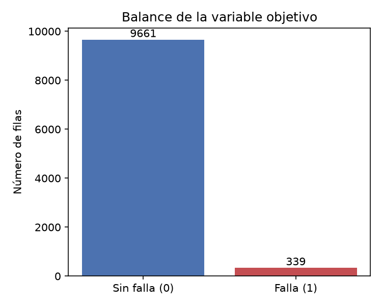
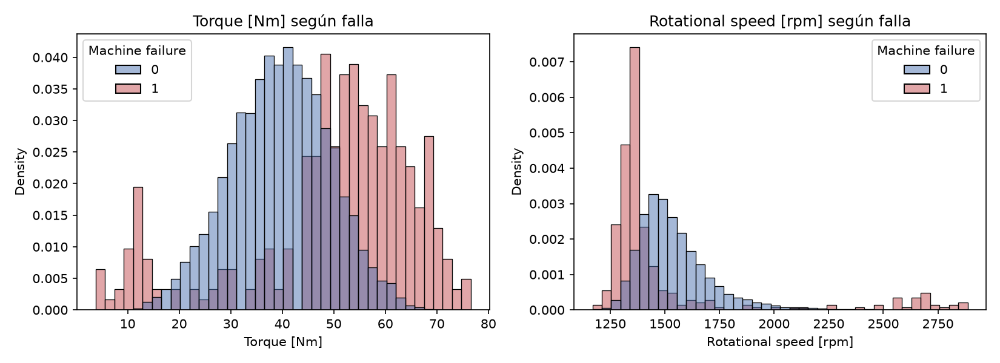
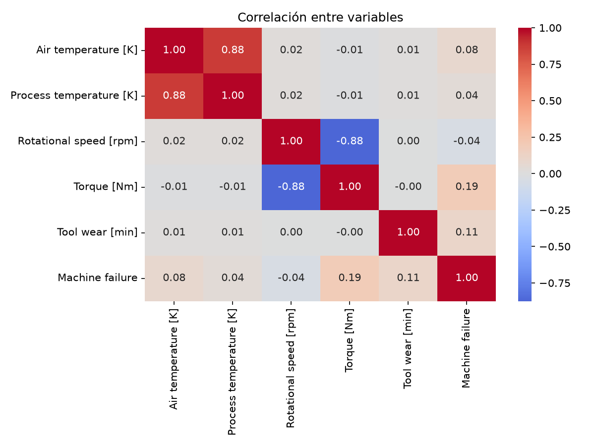
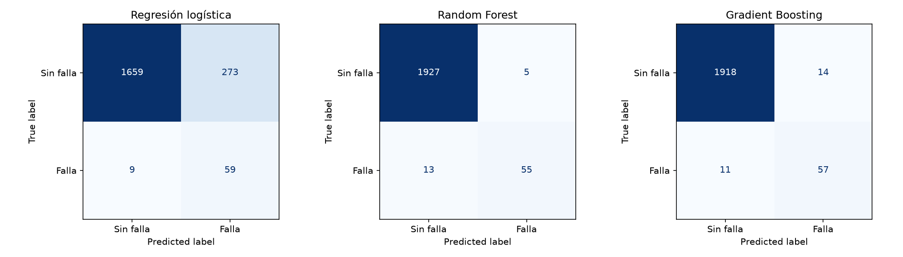
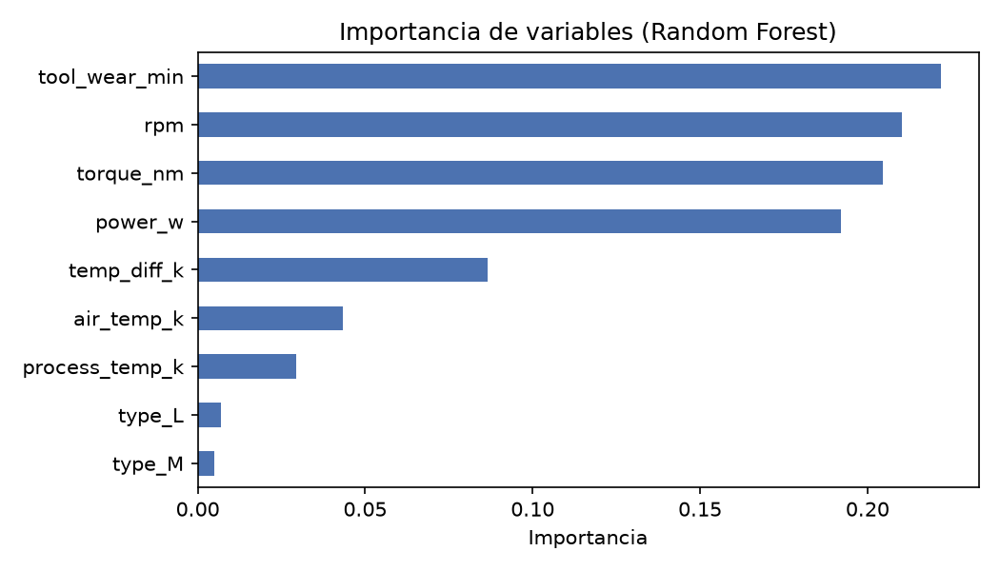

# mantenimiento-predictivo-sensores

# Predicción de fallas de máquinas con sensores (AI4I 2020)

Proyecto de punta a punta: exploración de datos, modelo de machine learning y dashboard en Streamlit para predecir fallas en una máquina a partir de lecturas de sensores.

## Problema
En manufactura, una falla inesperada detiene la producción. El objetivo es predecir si una máquina fallará según sus lecturas de sensores, priorizando detectar fallas reales (recall) sin generar demasiadas falsas alarmas.

## Datos
- **Fuente:** AI4I 2020 Predictive Maintenance Dataset (UCI Machine Learning Repository / Kaggle). Es un conjunto **sintético** que imita datos reales de mantenimiento predictivo.
- **Tamaño:** 10 000 filas, 14 columnas originales.
- **Archivo original (intacto):** `data/raw/ai4i2020.csv`
- **Archivo limpio:** `data/clean/ai4i2020_clean.csv`

### Diccionario de columnas
| Columna original | Nombre en `clean` | Significado |
|---|---|---|
| UDI | udi | Identificador de la fila (1 a 10000) |
| Product ID | product_id | Identificador del producto; la primera letra es el tipo |
| Type | type | Calidad del producto: L (baja), M (media), H (alta) |
| Air temperature [K] | air_temp_k | Temperatura del aire, en kelvin |
| Process temperature [K] | process_temp_k | Temperatura del proceso, en kelvin |
| Rotational speed [rpm] | rpm | Velocidad de rotación |
| Torque [Nm] | torque_nm | Torque, en newton-metro |
| Tool wear [min] | tool_wear_min | Minutos de desgaste de la herramienta |
| Machine failure | machine_failure | **Variable objetivo**: 1 si hubo falla, 0 si no |
| TWF | twf | Falla por desgaste de herramienta |
| HDF | hdf | Falla por disipación de calor (rpm baja y poca diferencia de temperatura) |
| PWF | pwf | Falla de potencia (potencia fuera de 3500–9000 W) |
| OSF | osf | Falla por sobreesfuerzo (desgaste × torque sobre un umbral según el tipo) |
| RNF | rnf | Falla aleatoria (0.1 % de probabilidad) |
| (nueva) | etiqueta_inconsistente | 1 si `machine_failure` no coincide con los 5 modos de falla |

## Limpieza y exploración
- Sin nulos ni duplicados; tipos de dato correctos.
- **Desbalance:** solo 339 de 10 000 filas (3.4 %) son fallas. Por eso se evalúa con precision, recall y F1, no solo accuracy.
- **Inconsistencias:** 27 filas (0.27 %) donde la etiqueta no coincide con los modos de falla (9 con falla sin modo activo y 18 con `RNF = 1` sin falla). Se conservan y se marcan en `etiqueta_inconsistente`.
- **Outliers (regla del IQR):** se conservan, porque son lecturas reales y muchas coinciden con fallas.
- **Hallazgos:**
  - Las fallas aparecen en los extremos de torque y de velocidad, no en valores centrales (relación no lineal).
  - Torque y rpm tienen correlación de -0.88; temperatura del aire y del proceso, 0.88.
  - La correlación lineal con la falla es baja (torque 0.19, desgaste 0.11), por lo que se esperan mejores resultados con modelos basados en árboles.

### Gráficos




## Modelo y resultados
Separación 80/20 estratificada, `class_weight="balanced"` y variables creadas a partir de las reglas físicas de falla (`power_w` = torque × velocidad angular y `temp_diff_k`). Se excluyeron los 5 modos de falla de las entradas para evitar fuga de datos.

| Modelo | Precision | Recall | F1 (prueba) | F1 (validación cruzada, 5 cortes) |
|---|---|---|---|---|
| Regresión logística (línea base) | 0.178 | 0.868 | 0.295 | 0.275 ± 0.018 |
| Random Forest | 0.917 | 0.809 | 0.859 | 0.806 ± 0.053 |
| **Gradient Boosting (elegido)** | 0.803 | 0.838 | 0.820 | **0.831 ± 0.025** |




## Conclusiones
1. Solo el 3.4 % de las lecturas son fallas (339 de 10 000), así que el accuracy engaña: se evaluó con precision, recall y F1 sobre la clase "Falla".
2. La regresión logística detecta 59 de 68 fallas (recall 0.868) pero genera 273 falsas alarmas (precision 0.178), lo que la hace inviable: una frontera lineal no captura que las fallas ocurren en los extremos de torque y rpm.
3. Random Forest y Gradient Boosting superan ampliamente la línea base. En validación cruzada, Gradient Boosting obtuvo F1 0.831 ± 0.025 y recall 0.804 contra F1 0.806 ± 0.053 y recall 0.753 de Random Forest, y fue el modelo más estable, por lo que se eligió como modelo final.
4. Las variables más influyentes son desgaste de herramienta, rpm, torque y potencia (≈83 % de la importancia en Random Forest); la potencia, construida a partir de torque y rpm, resultó clave, mientras que el tipo de producto y las temperaturas por separado aportan poco.
5. Limitaciones: el dataset es sintético y la prueba tiene solo 68 fallas. El modelo final aún deja pasar 11 de ellas (16 %). Con más tiempo se ajustaría el umbral de decisión para priorizar recall, se afinarían hiperparámetros y se validaría con datos reales.

## Dashboard
Filtros por tipo, rpm y desgaste; indicador de tasa de falla; gráfico de variables por falla; y un simulador con sliders que predice la probabilidad de falla.


## Cómo ejecutarlo
```bash
git clone https://github.com/TU_USUARIO/mantenimiento-predictivo-sensores.git
cd mantenimiento-predictivo-sensores
conda create -n portafolio-datos python=3.11 -y
conda activate portafolio-datos
pip install -r requirements.txt
streamlit run app/app.py
```
Notebooks: `notebooks/01_limpieza_exploracion.ipynb` y `notebooks/02_modelo.ipynb`.

## Cómo ejecutarlo como un clon
```bash
cd %USERPROFILE%\Desktop
git clone https://github.com/TU_USUARIO/mantenimiento-predictivo-sensores.git
cd mantenimiento-predictivo-sensores
conda create -n prueba-clon python=3.11 -y
conda activate prueba-clon
pip install -r requirements.txt
streamlit run app/app.py

```
## Estructura del repositorio
data/raw      datos originales sin modificar
data/clean    datos limpios
notebooks/    exploración y modelo
src/          código reutilizable
app/          dashboard en Streamlit
sql/          consultas
reports/figures/  gráficos
```
